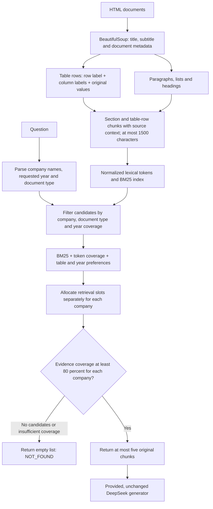

# FTEC5660 — Homework 4

Lexical retrieval for financial question answering. The five homework functions are implemented in `hw4.py`; the supplied generator, runner and scoring code are unchanged.

## Run

Requires Python 3.10 or newer and a DeepSeek API key.

```bash
python3 -m venv .venv
source .venv/bin/activate
pip install -r requirements.txt
cp .env.example .env
```

Set `DEEPSEEK_API_KEY` in `.env`, then run:

```bash
python hw4.py --data-folder public_test
python -m unittest -v test_hw4
python ablation.py --generate --output-dir experiments/single-factor-online
```

The first command writes the official `results.csv`. The third runs the unchanged generator for every ablation variant and records accuracy, token usage, time, and per-question evidence. An API error aborts the ablation instead of recording invented answers. For reproducible retrieval-only evaluation without API access:

```bash
python ablation.py --output-dir experiments/single-factor-offline
```

No additional dependencies beyond the supplied `requirements.txt` are needed. Do not commit `.env`, virtual environments or serialized indexes. Every run reconstructs its index from the supplied HTML corpus.

### Validation status

The saved offline and online experiments are real runs on the 40 public documents and 60 public questions. All six unittest cases pass, including public scoring contracts and synthetic unseen-company/year cases. On 23 November 2026, network-enabled validation completed successfully with the supplied DeepSeek generator. Tests used locally available packages from another Python environment; installation from a fresh environment has not been verified.

`results.csv` contains the successful official run: 60/60 correct answers and 75/75 estimated points for Tasks 1–4. It took 8.9 seconds, with 46 generator calls, 24,494 input tokens and 162 output tokens. The runner's estimated cost was USD 0.0038, using its supplied pricing constants rather than a billing receipt. `experiments/single-factor-online/` contains all 15 completed generator-backed ablations. The older `experiments/generator-attempt.log` records the superseded network-failed attempt and does not describe the current results. The code has no alternative generator or substituted model.

## Homework 4 solution

### Pipeline



I parse document identity from the HTML cover rather than file names. Each table row is serialized with its column labels and unchanged values, while its caption preserves units. Narrative paragraphs and list entries are kept separately; oversized text is split at word boundaries. Every chunk repeats its company and local section, and table chunks also repeat the caption. This keeps competing facts small and interpretable while preserving document probes. A BM25 index uses lowercase alphabetic tokens, a stop-word list and a small financial synonym map. Query rules identify companies, the requested year and document type. Exact normalized company filtering avoids confusing similar names. Annual reports support their own year and the preceding year's table columns; calls and research reports can support other years explicitly present in their text. Candidates are ranked using BM25 plus query-token coverage and modest table/year preferences. Retrieval reserves slots for each company in a comparison. A missing company/year/type candidate set, or insufficient lexical coverage, returns `[]`. All five functions are deterministic and use no LLM calls, embeddings, external data, or answer files.

### Design details

- **Tables:** the first row supplies column headers. Data rows retain punctuation, including commas and parenthesized negatives. A long row is continued with its row label so the output line remains short. The implementation targets the simple table structure supplied with the assignment; arbitrary merged or multi-level table headers are not supported.
- **Chunks:** 4,308 chunks on the public corpus. The metadata includes the required four fields plus `section` and `is_table`. Only original document text, table serialization and short contextual headers appear in chunks.
- **Question parsing:** patterns handle possessives, comparison alternatives, audit questions, broker questions and headquarters questions. A fallback uses company names discovered from HTML. Unknown companies captured from the question are retained rather than mapped to a similar known company. Word boundaries prevent “operating” from being mistaken for “rating.”
- **Years:** `parse_query` returns the requested year, not the report year. For example, a prior-year table value can come from the next year's annual report. A forecast question can point to a later year in a research report. Narrative facts such as a CFO appointment require the annual report of the requested year.
- **Scoring:** `BM25 + 12 × coverage + 3 × is_table + 1 × exact_report_year`. Coverage is the fraction of distinct normalized query tokens present in the chunk. Company names and a broker-name clause are removed from the scoring query because company identity is handled by filtering.
- **Budget:** a single-company question gets up to five chunks; a two-company comparison gets up to two from each company. The unused fifth slot avoids adding unnecessary competing evidence. Returned objects are the original indexed Documents.
- **Abstention:** each requested company must have candidates, and the maximum coverage among its top five candidates must reach 0.8. This threshold was selected during public-set development, so its measured performance is development performance, not a held-out estimate.

### Ablation study

The submitted study uses **15 cumulative configurations, B0–V14**, with one feature switch enabled per transition. The exact switches are saved in `experiments/single-factor-online/configurations.json`; the runner asserts that adjacent configurations differ in exactly one switch. All variants use the same corpus, questions, BM25 defaults and supplied generator. No retrieval function reads answers or evidence labels.

B0 uses BeautifulSoup `get_text()`, `RecursiveCharacterTextSplitter(chunk_size=1200, chunk_overlap=150)`, the required metadata, lowercased whitespace tokens, and corpus-wide BM25 top-five retrieval. It never abstains and does not call `parse_query`; a regression test enforces this. Cleaning, chunking, contextual headers, alphabetic tokenization, stop words, synonyms, query preprocessing and each scoring bonus are switched separately. The final V14 output is checked against `hw4.retrieve` for every question, including chunk order, content and metadata.

Source: `experiments/single-factor-online/summary.csv`, measured on 23 November 2026. Recall and kept use 46 answerable questions; rejected uses 14 unanswerable questions; answer accuracy uses all 60. Matching offline measurements are in `experiments/single-factor-offline/`. The older seven-row studies in `experiments/online/` and `experiments/offline/` are historical results, superseded by this study; their variant labels must not be mixed with the current labels.

| Variant | Only change from previous row | Chunks | Recall@5 | Kept | Rejected | Answer accuracy |
| --- | --- | ---: | ---: | ---: | ---: | ---: |
| B0 | Naive baseline | 291 | 34.78% | 100.00% | 0.00% | 50.00% |
| V1 | Preserve table labels | 340 | 30.43% | 100.00% | 0.00% | 46.67% |
| V2 | Remove navigation and non-content HTML | 336 | 32.61% | 100.00% | 0.00% | 48.33% |
| V3 | Replace fixed-size chunks with document blocks and table rows | 4308 | 23.91% | 100.00% | 0.00% | 41.67% |
| V4 | Prepend company and section context | 4308 | 47.83% | 100.00% | 0.00% | 63.33% |
| V5 | Use alphabetic token boundaries | 4308 | 67.39% | 100.00% | 0.00% | 76.67% |
| V6 | Remove stop words | 4308 | 67.39% | 100.00% | 0.00% | 71.67% |
| V7 | Normalize financial synonyms | 4308 | 69.57% | 100.00% | 0.00% | 75.00% |
| V8 | Remove parsed entity clauses from ranking query | 4308 | 28.26% | 100.00% | 0.00% | 41.67% |
| V9 | Add query-token coverage score | 4308 | 30.43% | 100.00% | 0.00% | 43.33% |
| V10 | Add table preference | 4308 | 30.43% | 100.00% | 0.00% | 43.33% |
| V11 | Add exact-report-year preference | 4308 | 34.78% | 100.00% | 0.00% | 50.00% |
| V12 | Enable company/type/year candidate filtering | 4308 | 100.00% | 100.00% | 71.43% | 100.00% |
| V13 | Allocate retrieval slots per company | 4308 | 100.00% | 100.00% | 71.43% | 100.00% |
| V14 | Enable evidence-coverage abstention | 4308 | 100.00% | 100.00% | 100.00% | 100.00% |

**What each transition changes and what the experiment shows:**

- **V1 — table serialization only:** replaces each table with labeled text before the unchanged fixed-size splitter. Recall falls from 16/46 to 14/46 and accuracy from 30/60 to 28/60. Labels alone do not resolve company selection, and altered text lengths shift chunk boundaries; officer questions q042, q048 and q059 lose evidence.
- **V2 — HTML cleaning only:** removes `nav`, `style`, `script` and `head` nodes; serialization, splitter and ranking remain unchanged. Recall rises to 15/46 and accuracy to 29/60. q048 is recovered, consistent with removing boilerplate and shifting boundaries, rather than any ranking improvement.
- **V3 — chunking only:** replaces recursive fixed-size splitting with document blocks and individual table rows. Rows carry their table caption as unit context. Company/section prefixes are still absent; the tokenizer and score remain unchanged. Recall falls to 11/46 and accuracy to 25/60. Short rows preserve precise values but often no longer contain the company name that the unfiltered scoring query needs.
- **V4 — contextual prefix only:** prepends the existing company and section header to each V3 chunk. The number of chunks, their metadata and their body text are identical; a test verifies that removing this one prefix exactly recovers every V3 chunk. Recall rises to 22/46 and accuracy to 38/60. q050 is among the recovered evidence hits. This separates contextualization's benefit from the chunk-boundary change.
- **V5 — token boundaries only:** replaces whitespace splitting with lowercase alphabetic tokens, on both documents and questions. Stop words, synonym mapping and query preprocessing remain off. Recall rises to 31/46 and accuracy to 46/60. Punctuation and possessive forms no longer bind words into incompatible tokens; q021 is recovered, although q008 and q056 lose evidence.
- **V6 — stop-word removal only:** applies the fixed stop-word list to the V5 tokens. Recall stays at 31/46, but four questions gain evidence and four lose it; accuracy falls to 43/60. Removing common words changes BM25 weighting, so unchanged aggregate recall hides substitutions rather than showing that every question is unaffected.
- **V7 — synonym mapping only:** applies the financial alias map after stop-word filtering. Recall rises to 32/46 and accuracy to 45/60. The new evidence hit is q027: mapping “headquartered” to “headquarters” makes the location passage easier to retrieve.
- **V8 — query preprocessing only:** parses the question to remove target-company mentions, broker clauses and possessive residue from the ranking query. Index tokens and score terms are unchanged; metadata filtering is still off. Recall drops to 13/46 and accuracy to 25/60 because company-specific discrimination is removed before a candidate filter supplies it. This is an interaction with later filtering, not a universal claim that preprocessing is beneficial.
- **V9 — coverage score only:** adds `12 × query-token coverage` to BM25. Recall rises to 14/46 and accuracy to 26/60, recovering q008. It helps match requested terms but cannot solve company identity on its own.
- **V10 — table preference only:** adds 3 to table-chunk scores. Recall stays at 14/46 and accuracy at 26/60. q036, q040 and q048 gain evidence while q008, q010 and q014 lose it; favoring numerical tables can displace relevant narrative evidence.
- **V11 — exact-year preference only:** adds 1 when report year equals requested year. Recall rises to 16/46 and accuracy to 30/60. q010, q037 and q059 gain evidence while q053 loses it. This is only a soft preference, not the candidate filtering introduced next.
- **V12 — metadata filtering only:** enables the query-derived company, document-type and year-coverage candidate constraint. Recall reaches 46/46 and accuracy 60/60. Ten unknown-company or unsupported-year questions now have no candidates. The four remaining unanswerable questions are still retrieved, but the fixed generator correctly declines them.
- **V13 — comparison allocation only:** reserves retrieval slots per target company instead of ranking all allowed companies in one pool. Recall and accuracy stay at their ceilings. The public set therefore demonstrates no incremental accuracy gain; input tokens fall from 27,729 to 26,705 because comparison contexts use at most four chunks.
- **V14 — abstention gate only:** requires sufficient evidence coverage for each company. Recall remains 46/46 and accuracy 60/60, while rejected improves from 10/14 to 14/14. This moves the four remaining rejections from the generator to retrieval, avoiding four API calls and saving 2,211 input tokens relative to V13.

These are order-dependent incremental effects, not a full factorial experiment. The negative intermediate results are retained rather than selecting only favorable transitions. In particular, the final system depends on the interaction between entity removal and metadata filtering. One run per variant does not establish statistical significance or a general latency improvement.

V14's online experiment took 10.436 seconds and used 24,494 generator input tokens plus 160 output tokens, about USD 0.00377 under the runner's supplied pricing constants. Its timing includes additional per-question equivalence assertions against the production retriever, so it is not a clean latency comparison with other variants. The independent official run took 8.9 seconds. Per-question CSVs retain the exact contexts and answers; `checks.json` records parsing and document checks. All student-side retrieval/model token counts remain zero.

### Error analysis and limitations

The baseline misses 30 of 46 answerable questions, including the two-company cash comparison q021 and the prior-year regional-revenue question q050. In these cases, generic financial vocabulary does not ensure the correct combination of company, year and row is in the top five. V1 also loses some officer-name questions that B0 retrieves, illustrating how changed text lengths can move evidence across fixed chunk boundaries. The saved contexts, rather than only aggregate scores, allow these changes to be inspected.

After metadata filtering, the remaining false keeps are q019, q025, q033 and q039: lobbying expenses, carbon-offset purchases, largest-customer revenue and customer churn. These questions concern real companies and covered years, but ordinary revenue or risk passages do not disclose the requested measure. For q033, a regional-revenue paragraph shares “revenue” and “customer” but lacks “largest”; its coverage is only two of three terms. The final 0.8 gate rejects it. This demonstrates why a plausible BM25 result is insufficient evidence for answering.

No retrieval or answer failures remain for V14 on the public set, but several risks remain. Public-set tuning may overestimate private performance. Rules may fail for unseen question syntax, and a synonym absent from the token map can trigger an incorrect rejection. The coverage gate checks words rather than semantic entailment; a passage can mention a metric without giving its value. Future work would test a broader paraphrase set and independently held-out company documents before changing thresholds. A successful Recall@5 result alone does not prove that the generator selects the correct number or name; the separate online answer check is therefore necessary.

The public scores are 55/55 for Tasks 1–3 and 20/20 for Task 4: 12/12 table scores are 1.0, 40/40 documents pass, all 60 parsed queries have all three fields correct, all 46 answerable questions retain complete evidence, all 14 unanswerable questions are rejected, and all 60 final answers are correct. These are public development results, not a claim about the private grade. Tasks 5–6 are assessed separately by the TAs.

## Task 6 — Reflection

*AI-assisted reflection, written as an aspirational position rather than a claim about personal experiences.*

If everyone has powerful personal AI agents in ten years, I would want to be someone whose judgment other people can trust. An agent may be able to produce an excellent plan, but choosing which problem deserves attention, deciding whose interests count, and accepting responsibility for the consequences would still matter. I would not want my identity to depend on being temporarily faster than a machine. I would want to be dependable when the right decision is uncertain or inconvenient.

The ambitions I would keep are understanding the world, becoming financially independent, building useful things and having meaningful relationships. Their outward form might change. Programming might involve more specification and verification than typing code; research might involve more choosing questions and challenging assumptions than collecting information. Independence would still matter because it gives me room to make choices according to my values. Success would mean using that freedom responsibly, rather than accumulating output for its own sake.

Beyond professional achievements, I would want to be known as someone who listens carefully, keeps promises and treats people well even when there is no reward. These qualities are easy to praise and harder to practice. A convincing message generated by an agent cannot replace actually showing up for a friend, acknowledging a mistake, or taking time to understand someone whose priorities differ from mine. I would rather people remember that they could rely on me than remember the volume of work I completed.

I would still be willing to struggle to learn, to maintain my health and to build relationships. The value of those struggles is partly in what they change in me. Asking an agent for a proof can provide an answer, but working through the proof develops my ability to recognize why it is true. An agent can design a training plan, but it cannot exercise on my behalf. It can suggest an apology, but it cannot make the decision to be vulnerable or repair trust for me. I would automate effort that merely consumes time while preserving effort that develops capacities I care about.

The skills that would keep me valuable include asking precise questions, recognizing weak evidence, understanding a domain deeply enough to challenge an attractive answer, and coordinating with people who disagree. Intellectual humility would be essential: fluent reasoning is not the same as justified reasoning. This homework offers a small example. A system can retrieve something that looks relevant and still answer for the wrong company or year. The responsible action may be to say that the evidence is insufficient. I would want to bring that discipline to decisions outside software as well.

If my value were no longer measured mainly by what I could produce, I would define myself through commitments: whom I care for, which principles I follow when they cost something, and what I choose to learn without needing to outperform others. Ability would remain useful, but it would be a means of serving those commitments. I would also resist treating people who produce less as worth less. A world with more capable technology should make it easier to recognize dignity independently of economic performance.

Tomorrow, I could begin by reserving a small period for learning without immediately delegating the difficult part, checking the evidence behind one AI-generated claim before using it, and making time for someone without multitasking. Before starting a task, I could ask whether I want only its output or also the experience of doing it. That distinction would help me use AI deliberately. The future I would hope for is one in which greater capability creates more room for care, curiosity and responsibility—and I can begin practicing those choices now.

## Submission checklist

- Official generator and online ablation completed successfully; results and measured accuracy are included. Verify dependency installation in a fresh environment before submission.
- Review the reflection so it represents the position you wish to submit.
- Keep `hw4.py`, `requirements.txt`, `ablation.py`, this README, and reproducible experiment results in the public fork.
- Do not include keys, virtual environments or index files.
- Submit the public GitHub repository link on Blackboard before 1 December, 23:59 HKT.
